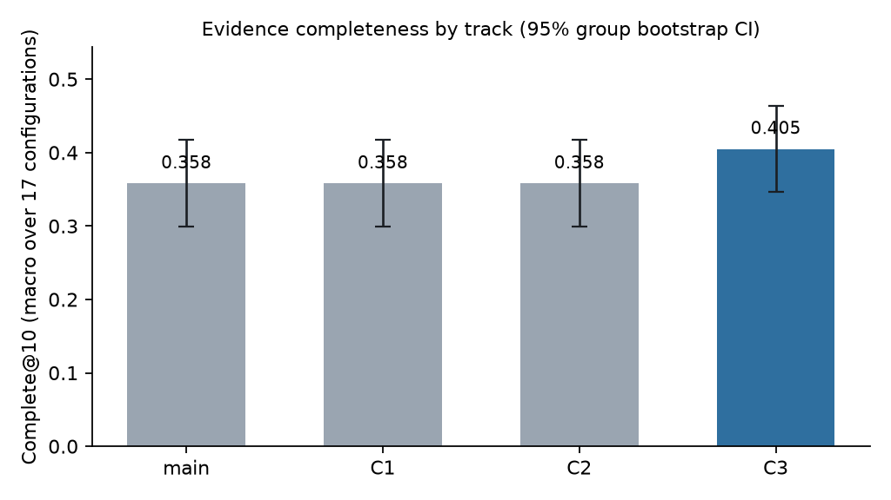
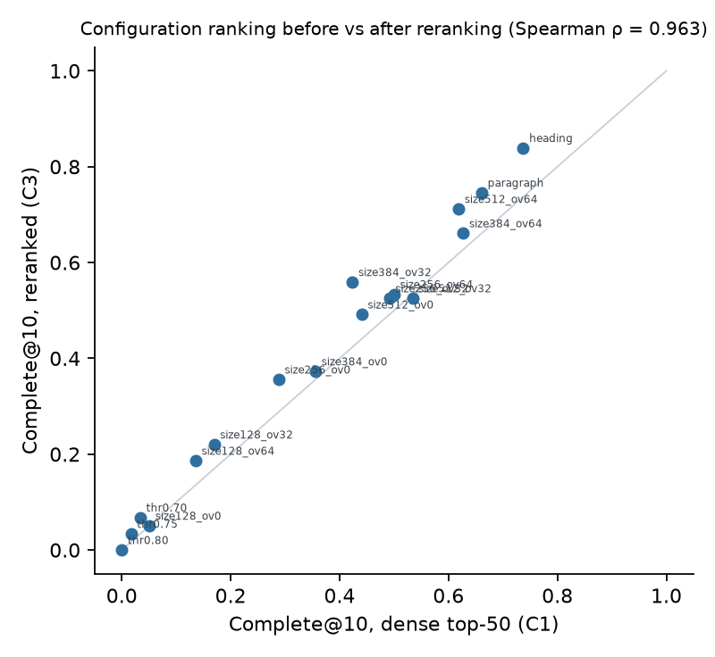

# Course-Policy RAG: Chunking and Reranking

> **Superseded 2026-11-12.** This is the first brief (28 Oct), kept verbatim as a record:
> `docs/TEACHER_BRIEF.docx` is hash-protected and must not be rebuilt. Two statements in it
> were later corrected in revision 3 of `docs/PROJECT_REPORT.docx`:
>
> * "a sentence chunk cannot contain a multi-sentence clause" is wrong as an explanation of
>   the semantic result — completeness is scored on the **union** of retrieved intervals, so
>   sentence chunks can combine; the family fails because the evidence is not retrieved
>   (`docs/DECISIONS.md` D15, `results/analysis/union_audit_test.json`);
> * "1,239 unused clauses" is the **usable** count; 1,771 clauses are unused and 1,239 of
>   those are usable (>=150 characters, not boilerplate).
>
> The revision-3 report also adds per-strategy results, a matched-seed learning-rate
> comparison, and an A5000 time/memory budget. See `docs/RUBRIC_CHECK.md` §G.

CPS5801 · progress report · corpus v0.1.5 · 172 questions · 17 chunking configurations ·
two-stage retrieval with a frozen reranker

## 1. Project Status and Completed Work

**Data collection.** 265 pages were crawled from 13 institutions under `robots.txt` and
crawl-delay rules; 36 documents entered the frozen corpus (14 course / 9 faculty /
13 institution, 12 institutions), giving 1,988 clauses and 2,007 retrieval units. Refused or
blocked sources are listed in `COMPLIANCE.md`.

**Preprocessing.** Each document is stored twice: an evidence layer that preserves character
offsets exactly, and a normalised retrieval layer with a character map back to evidence.
Clause spans are validated, and split pieces must tile their clause span — `split-span
errors: 0`. Chunk sizes are measured with the real model tokenizer (maximum 509 tokens,
`over-limit 0`).

**Retrieval system.** The bi-encoder `BAAI/bge-small-en-v1.5` is used **frozen**: 384
dimensions, CLS pooling, L2-normalised vectors, exact search with FAISS `IndexFlatIP`. No
fine-tuning of the encoder was performed, so all 17 configurations share one embedding model
and differ only in how text is cut.

**Baselines.** Four chunking families, 17 configurations: fixed-length (128/256/384/512
tokens × overlap 0/32/64), paragraph, heading, and semantic splitting (thresholds
0.70/0.75/0.80).

**Training.** One cross-encoder, `BAAI/bge-reranker-base`, fine-tuned on the development
split only and applied unchanged to every configuration. On a 6 GB laptop GPU the full
278 M-parameter update does not fit, so the first 10 of 12 encoder layers are frozen
(85.6 M trainable) and Adafactor replaces AdamW.

**Evaluation.** Tool-assisted annotation produced 172 questions (112 development / 60 test,
59 test groups); all were reviewed and accepted by the student. Scoring counts a clause only
when the retrieved intervals contain its entire annotated span, and a question is "complete"
only when one whole minimal sufficient evidence set is covered.

## 2. Experimental Log

Every row is taken from `experiments/log.jsonl` and `experiments/aborted_runs.jsonl`; failed
and weaker runs are kept.

| date | run | corpus | model / training configuration | seed | result |
|---|---|---|---|---|---|
| 10-21 | index build | v0.1.5 | bge-small, FAISS, 17 configs, 2,007 units | 20261013 | 17 indexes, 0 over limit |
| 10-24 | pilot test | v0.1.5 | dense top-10, no reranker | 20261013 | macro Complete@10 0.357 |
| 10-25 01:59 | full fine-tune | v0.1.5 | AdamW, batch 8×2, fp16 | 20261027 | **aborted**: 6 GB VRAM paging, 20 min/epoch |
| 10-25 03:05 | full fine-tune | v0.1.5 | AdamW, batch 2×8 | 20261027 | **aborted**: optimizer state is the floor |
| 10-25 03:20 | full fine-tune | v0.1.5 | Adafactor, batch 8×2 | 20261027 | **aborted**: fp32 weights + gradients still too large |
| 10-25 03:27 | fine-tune, lr 1e-5 | v0.1.5 | Adafactor, 10 layers frozen, batch 8×2, 4 negatives | 20261027 | **selected**: val macro Complete@10 0.388 |
| 10-25 03:41 | fine-tune, lr 2e-5 | v0.1.5 | same, lr 2e-5 | 20261037 | weaker: 0.342, kept in the log |
| 10-28 | four-track test | v0.1.5 | frozen reranker, 4 tracks × 17 configs | 20261013 | C3 0.405 vs main 0.358 |

## 3. Preliminary Results and Analysis

The evaluation is a 2×2 design: candidate pool (top-10 vs top-50) × reranker (off vs on).
Two of the four contrasts are arithmetic identities — reranking a fixed ten-chunk set, or
taking the first ten of a top-50, cannot change Recall@10 / Hit@10 / Complete@10 — so they
are asserted (maximum difference 0.0) rather than tested.

| track | pool | reranker | Complete@10 | 95% CI | MRR |
|---|---|---|---|---|---|
| main | 10 | no | 0.358 | [0.299, 0.418] | 0.276 |
| C1 | 50 | no | 0.358 | [0.299, 0.418] | 0.282 |
| C2 | 10 | yes | 0.358 | [0.299, 0.418] | 0.312 |
| **C3** | 50 | yes | **0.405** | [0.347, 0.464] | **0.322** |

The primary comparison, C3 − C1, is **+0.047 [−0.005, +0.095], Holm-adjusted p = 0.15**: the
direction is consistent but the interval includes zero. On the development split the same
comparison was +0.110 [+0.079, +0.141], p = 0.001. The effect therefore did not replicate at
the same size, and the honest reading is *suggestive, not established*.

Reranking does help where it can: at a fixed ten-chunk pool it improves Recall@3 by +0.058
(p = 0.014) and MRR by +0.036, and it roughly halves the gap at matched token budgets
(recall@512: 0.215 → 0.254).

Two conclusions are stable. First, **the chunking ranking survives reranking** (Spearman
ρ = 0.963 between C1 and C3): structural splitting (heading 0.833, paragraph 0.750) stays
ahead of fixed-length splitting (best 0.717), and sentence-level semantic splitting remains
unusable (0.000–0.067) because a sentence chunk cannot contain a multi-sentence clause.
Second, **the reranker shifts the level, not the order** — it adds roughly five points of
completeness to every configuration, including the weak ones.

## 4. Problems, Changes, and Research Decisions

- **Offsets must survive normalisation.** A single normalised corpus silently breaks span
  annotation, so a dual-layer design with a character map was adopted.
- **Split pieces over-claimed coverage.** Each piece originally reported its whole clause
  span, inflating completeness; per-piece evidence ranges plus a tiling assertion fixed it.
- **Leakage was real.** The first audit compared only question wording and missed 20 clauses
  used on both sides of the split. Clusters defined by shared gold evidence are now never
  divided; leakage is 0.
- **The test split is no longer unseen.** It was used once as an exploratory pilot; the
  formal run is a re-evaluation with frozen settings, and is reported as such.
- **Invariance replaced a broken selection metric.** Selecting on Complete@10 over a reranked
  top-10 is selecting on a constant; selection now uses the top-50 pool, and the two
  invariant contrasts are asserted, not tested.
- **Statistics resample groups.** 60 questions come from 59 groups and each appears under 17
  configurations, so resampling questions or cells would overstate precision.
- **Hardware forced partial fine-tuning.** The 6 GB card could not hold a full AdamW update;
  Adafactor plus freezing 10 of 12 layers made training feasible at the cost of a weaker
  model. The A5000 was unavailable, so all numbers come from the canonical 3060.

Full rationale is in `docs/DECISIONS.md`.

## 5. Remaining Work and Feasibility

| item | status | effort |
|---|---|---|
| four-track test run | done, one formal attempt | — |
| statistics and figures | done | — |
| this brief (3–5 pages) | done | — |
| rerun the fine-tune on an A5000 | optional; full fine-tuning was better per epoch (0.396 at epoch 1) | 1–2 h GPU |
| second held-out set (new questions from 1,239 unused clauses) | optional, would restore an unseen split | 2 days |
| per-document and per-domain expansion | optional; `resources` has 7 test questions | 1 day |

The required work is complete. The optional items would strengthen the weak result in §3 but
are not needed for the assignment; the first of them is the cheapest and would also remove
the "partial fine-tuning" limitation.

## 6. AI Disclosure

AI assistance was used, and the arrangement was approved by the supervisor for this course
assignment.

- **Question drafting.** Questions and reference answers were drafted by an AI assistant
  (DeepSeek) from clauses in the frozen corpus. Every question records its provenance
  (`provenance.generated_by`, model, timestamp). The student reviewed all 172 questions,
  raised 23 specific defects (wrong answers, non-minimal evidence, unnatural pairings,
  leakage), which were corrected, and then accepted every question; the sign-off is logged
  with a timestamp in `reports/lock_audit.jsonl`.
- **Code.** Pipeline scripts were written with AI assistance. All data transformations are
  asserted and covered by 95 automated tests; the corpus manifest hashes every artefact.
- **Text.** This brief and the analysis narrative were drafted with AI assistance and
  reviewed by the student.
- **What the AI did not do.** It did not decide the research question, the evaluation
  protocol, or the interpretation; those were set by the student and supervisor. No
  inter-annotator agreement is claimed, because there was no second human annotator.
- **Models.** `BAAI/bge-small-en-v1.5` (frozen encoder), `BAAI/bge-reranker-base`
  (fine-tuned reranker), DeepSeek (annotation and drafting).
