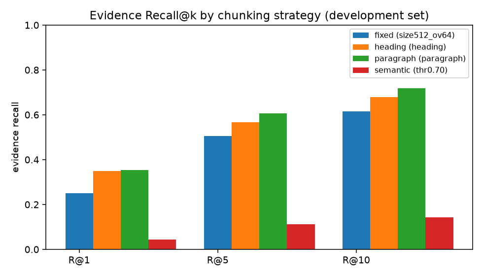
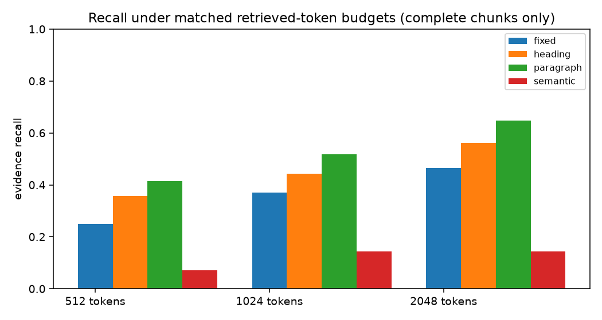

# Chunking strategies for course-policy retrieval - results

Corpus **v0.1.5** · 36 documents · 2007 clause units · max chunk 509 tokens

Embedding model: `BAAI/bge-small-en-v1.5` · device `cpu` · index `FAISS IndexFlatIP` (exact search)

Development questions: **112** · configurations evaluated: **17**

## How to read this

- `Recall@k` counts a clause only when the retrieved evidence intervals contain its **entire** annotated span. Partial overlap is reported separately as `partial@10` and never counted as a hit.
- `Complete@10` is 1 only when one whole sufficient evidence set is covered.
- Parameter selection used the development set with **group-disjoint** cross-validation; the test split is untouched until it is locked.

## Chosen configuration per strategy (development)

| strategy | config | questions | chunks | R@1 | R@5 | R@10 | Complete@10 | partial@10 | MRR | index MB | embed s | latency ms |
|---|---|---|---|---|---|---|---|---|---|---|---|---|
| fixed | size512_ov64 | 112 | 454 | 0.250 | 0.504 | 0.616 ± 0.428 | 0.509 | 0.658 | 0.429 | 0.70 | 72.8 | 0.161 |
| heading | heading | 112 | 635 | 0.348 | 0.567 | 0.679 ± 0.400 | 0.562 | 0.679 | 0.560 | 0.98 | 88.9 | 0.018 |
| paragraph | paragraph | 112 | 1203 | 0.353 | 0.607 | 0.719 ± 0.365 | 0.580 | 0.719 | 0.604 | 1.85 | 538.5 | 0.063 |
| semantic | thr0.70 | 112 | 5506 | 0.045 | 0.112 | 0.143 ± 0.279 | 0.054 | 0.360 | 0.119 | 8.46 | 122.6 | 0.063 |

### Cross-validated procedure score (5-fold, 106 groups)

| strategy | CV R@10 | sd | folds |
|---|---|---|---|
| fixed | 0.603 | 0.055 | 5 |
| heading | 0.680 | 0.099 | 5 |
| paragraph | 0.719 | 0.081 | 5 |
| semantic | 0.142 | 0.045 | 5 |

This is the honest estimate of *tuning plus selection*: the best configuration is picked on each training fold and scored on the held-out fold, so it cannot benefit from having seen the evaluation questions.

## Held-out test results — PILOT / exploratory, not final

> **Status: pilot.** This was the first test-split evaluation (top-10 dense retrieval, no reranker, 2026-10-24). It is retained for provenance only. The formal result will come from a single four-track run (dense top-10 / dense top-50 / reranked top-10 / reranked top-50) executed once after the reranker is frozen. Archived copy: `results/pilot/`.

Configurations were selected on the development split only; these are the same configurations scored once on the locked test split.

| strategy | config | dev R@10 | test R@10 | dev Complete@10 | test Complete@10 | test R@1 | test R@5 | test MRR |
|---|---|---|---|---|---|---|---|---|
| fixed | size512_ov64 | 0.616 | 0.692 | 0.509 | 0.617 | 0.300 | 0.517 | 0.483 |
| heading | heading | 0.679 | 0.767 | 0.562 | 0.733 | 0.483 | 0.642 | 0.613 |
| paragraph | paragraph | 0.719 | 0.692 | 0.580 | 0.667 | 0.400 | 0.633 | 0.541 |
| semantic | thr0.70 | 0.143 | 0.092 | 0.054 | 0.033 | 0.025 | 0.083 | 0.086 |

## Matched retrieved-token budgets

| strategy | config | recall @512 | recall @1024 | recall @2048 |
|---|---|---|---|---|
| fixed | size512_ov64 | 0.250 | 0.370 | 0.464 |
| heading | heading | 0.357 | 0.442 | 0.562 |
| paragraph | paragraph | 0.415 | 0.518 | 0.647 |
| semantic | thr0.70 | 0.071 | 0.143 | 0.143 |

Chunks are admitted in rank order and only as complete chunks: if the next chunk does not fit the remaining budget, selection stops there. Nothing is truncated and no smaller lower-ranked chunk is skipped ahead to.

## By evidence type (Recall@5)

| strategy | config | single-clause | rule-and-exception | cross-clause |
|---|---|---|---|---|
| fixed | size512_ov64 | 0.576 | 0.457 | 0.500 |
| heading | heading | 0.667 | 0.467 | 0.606 |
| paragraph | paragraph | 0.849 | 0.467 | 0.561 |
| semantic | thr0.70 | 0.030 | 0.163 | 0.121 |

## By policy domain (Recall@5)

| strategy | config | attendance | exam | grading | integrity | late | resources |
|---|---|---|---|---|---|---|---|
| fixed | size512_ov64 | 0.263 | 0.386 | 0.647 | 0.575 | 0.477 | 0.833 |
| heading | heading | 0.263 | 0.614 | 0.706 | 0.525 | 0.523 | 0.917 |
| paragraph | paragraph | 0.395 | 0.636 | 0.618 | 0.600 | 0.591 | 0.917 |
| semantic | thr0.70 | 0.132 | 0.204 | 0.118 | 0.025 | 0.114 | 0.042 |

## All configurations (development, ranked)

| strategy | config | questions | R@10 | Complete@10 |
|---|---|---|---|---|
| paragraph | paragraph | 112 | 0.719 | 0.580 |
| heading | heading | 112 | 0.679 | 0.562 |
| fixed | size512_ov64 | 112 | 0.616 | 0.509 |
| fixed | size384_ov64 | 112 | 0.603 | 0.491 |
| fixed | size384_ov32 | 112 | 0.558 | 0.429 |
| fixed | size512_ov32 | 112 | 0.554 | 0.455 |
| fixed | size512_ov0 | 112 | 0.495 | 0.366 |
| fixed | size256_ov32 | 112 | 0.487 | 0.348 |
| fixed | size256_ov64 | 112 | 0.482 | 0.339 |
| fixed | size384_ov0 | 112 | 0.446 | 0.268 |
| fixed | size256_ov0 | 112 | 0.312 | 0.214 |
| fixed | size128_ov32 | 112 | 0.237 | 0.143 |
| fixed | size128_ov64 | 112 | 0.223 | 0.152 |
| semantic | thr0.70 | 112 | 0.143 | 0.054 |
| semantic | thr0.75 | 112 | 0.076 | 0.018 |
| fixed | size128_ov0 | 112 | 0.071 | 0.018 |
| semantic | thr0.80 | 112 | 0.062 | 0.009 |

## Limitations to state in the write-up

- Questions were drafted with AI assistance from the frozen corpus and reviewed by the student; they are not independently double-annotated, so no inter-annotator kappa is reported for this run.
- The corpus is concentrated: a few large documents supply most clauses, so pooled means should be read alongside the per-document breakdown.
- `resources` is the thinnest domain; domain-level comparisons there are based on few questions.
- The test split has been evaluated; see `summary_test.csv`.

